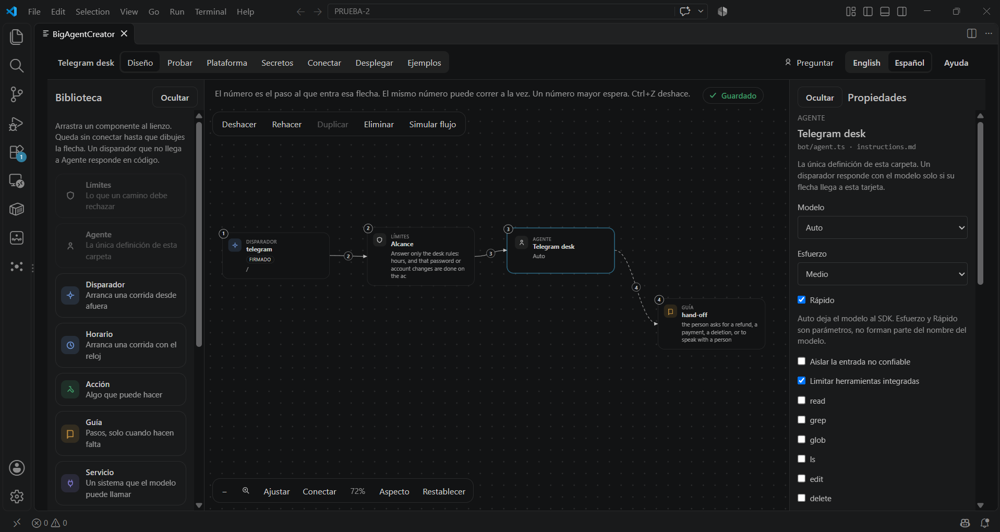
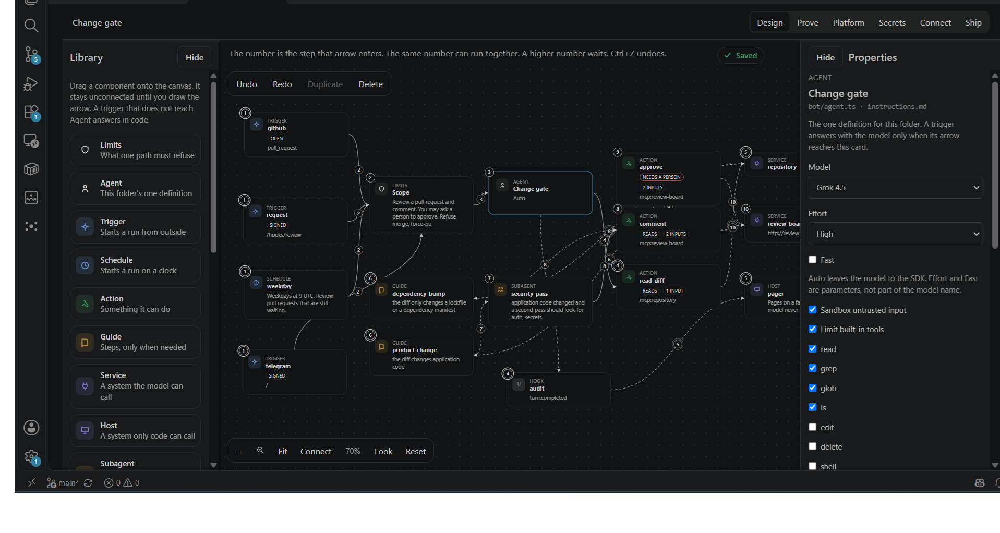
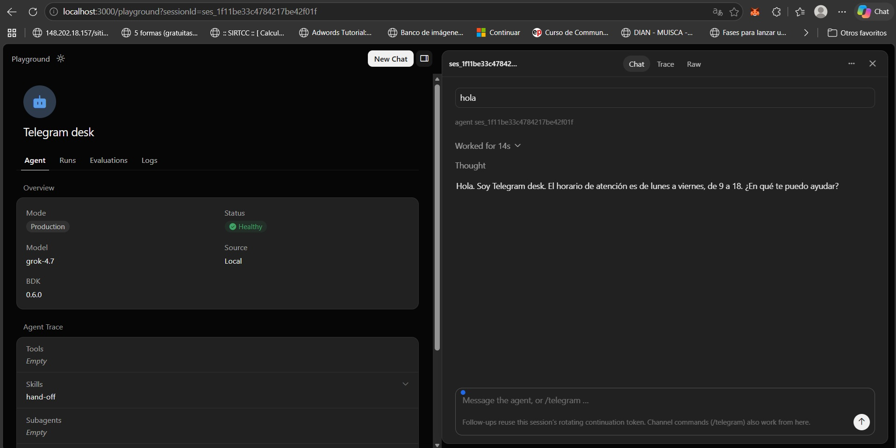
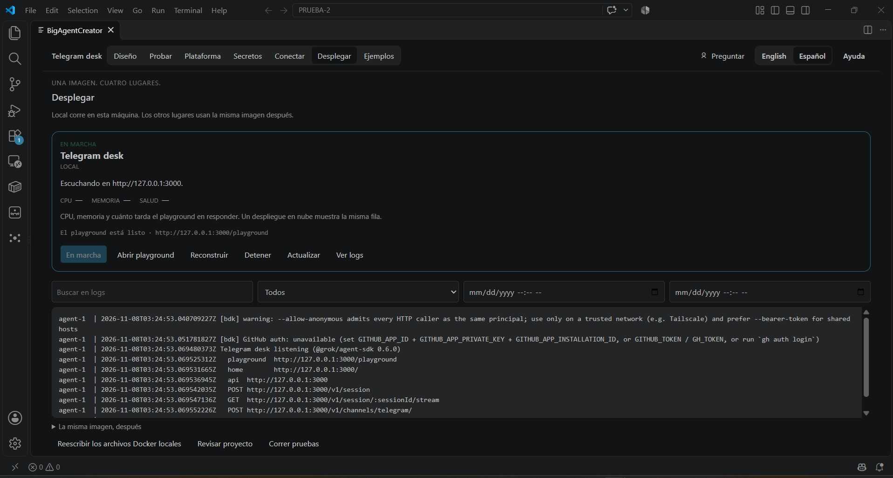

# BigAgentCreator

[English](./README.md) | **Español**



Extensión para VS Code y Cursor. Diseñas un agente de IA como un flujo en un lienzo y lo guardas como carpeta: disparadores, límites, herramientas, guías y un chat de Telegram. Esa carpeta corre en Docker y se prueba en el playground. Un camino que no llega a la tarjeta Agent responde en código y no llama a un modelo. Los valores secretos se quedan en `.env`.

La primera versión para la tienda es la **0.2.0**. La extensión está en `apps/extension`. La página que la gente lee en la tienda es `apps/extension/README.md`, en inglés. La frase de búsqueda es `description` en `apps/extension/package.json`. El camino desde una carpeta vacía hasta el playground está en [Empezar](./docs/start.es.md).

## También en la pantalla

| Un flujo más grande | Playground | Telegram |
| --- | --- | --- |
|  |  |  |

## Qué puedes hacer

| Zona | Para qué |
| --- | --- |
| Design | El flujo. Una definición Agent por carpeta. Disparadores, límites, acciones y guías. |
| Prove | Casos fijos de evaluación. |
| Platform | Archivos que el lienzo no dibuja. |
| Secrets | Los nombres en el proyecto. Los valores en `.env`. |
| Connect | Decirle a un servicio de afuera dónde vive el agente. Telegram es el que funciona. |
| Ship | Construir y correr la imagen local. El playground es `http://127.0.0.1:3000/playground`. |

Un disparador que no llega a Agent responde en código y no llama al modelo. La carpeta igual guarda un `bot/agent.ts` pequeño para que `agent-sdk serve` arranque.

## Ejemplos

| Carpeta | Uso |
| --- | --- |
| `examples/hello` | Solo el playground. Escribes hi y responde hello. |
| `examples/telegram-desk` | Un chat de Telegram. El primer despliegue para aprender. |
| `examples/support-desk` | Una mesa con base de conocimiento. |
| `examples/change-gate` | Un recorrido de las piezas del lienzo. |

Abre la carpeta y luego BigAgentCreator.

## Construir

```bash
cd apps/extension
npm install
npm test
npm run compile
npx @vscode/vsce@2.32.0 package --allow-missing-repository --skip-license
```

Instala el `.vsix` desde el editor, o publícalo.

## Publicar en la tienda

El publisher en `package.json` es `BigAgentCreator`. Hace falta un publisher del Marketplace con ese id y un token de acceso personal.

Desde `apps/extension`, con `npm test` en verde:

```bash
npx @vscode/vsce@2.32.0 login BigAgentCreator
npx @vscode/vsce@2.32.0 publish --skip-license
```

Antes de la primera publicación:

- El icono es `media/icon.png` (256 px). No lo cambies por un archivo con texto dentro.
- `README.md` en `apps/extension` es la página de la tienda. Se queda en inglés.
- El git público es https://github.com/salim-castellanos/big-agent-creator. `repository` ya está puesto, así que publish no necesita `--allow-missing-repository`.
- Todavía no hay archivo de licencia. Agrégalo antes de publicar si quieres que la ficha la nombre.

Lo que sigue a la 0.2.0 está en [ROADMAP.md](./ROADMAP.md): la misma imagen en AWS, GCP y Azure, y después un digest versionado en lugar de un rebuild sin nombre. Otro ejecutor de modelo no entra en esa línea.
