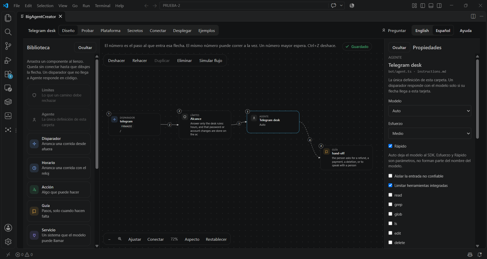
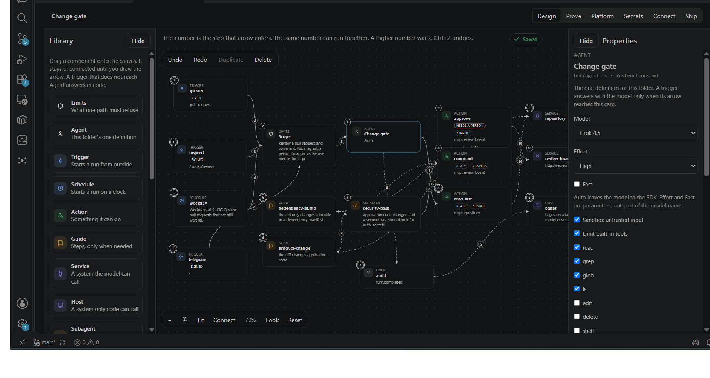
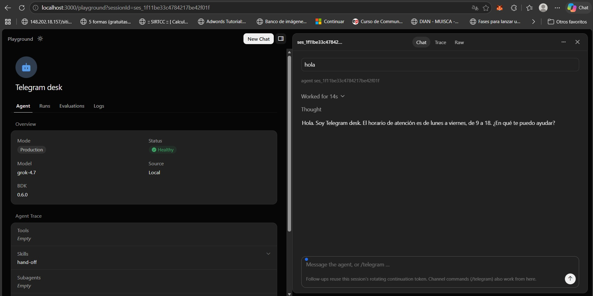
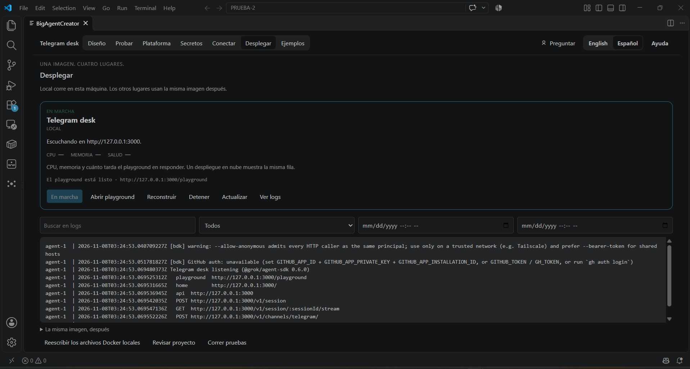

# BigAgentCreator

**English** | [Español](./README.es.md)



An extension for VS Code and Cursor. You design an AI agent as a workflow on a canvas and save it as a folder: triggers, limits, tools, guides, and a Telegram chat. You run that folder in Docker and try it in the playground. A path that never reaches the Agent card answers in code and does not call a model. Secret values stay in `.env`.

The first Marketplace release is **0.2.0**. The extension is `apps/extension`. The page people read in the store is `apps/extension/README.md`. The one-line search text is the `description` in `apps/extension/package.json`. The path from an empty folder to a playground reply is [Start](./docs/start.md).

## Also on the screen

| A larger flow | Playground | Telegram |
| --- | --- | --- |
|  |  |  |

## What you can do

| Area | What it is for |
| --- | --- |
| Design | The flow. One Agent definition per folder. Triggers, limits, actions, and guides. |
| Prove | Fixed evaluation cases. |
| Platform | Files the canvas does not draw. |
| Secrets | Names in the project. Values in `.env`. |
| Connect | Tell an outside service where the agent lives. Telegram is the one that works. |
| Ship | Build and run the local image. The playground is `http://127.0.0.1:3000/playground`. |

A trigger that does not reach Agent answers in code and does not call the model. The folder still has a small `bot/agent.ts` so `agent-sdk serve` can boot.

## Examples

| Folder | Use |
| --- | --- |
| `examples/hello` | Playground only. Type hi, get hello. |
| `examples/telegram-desk` | One Telegram chat. Load it from **Examples**. The first deploy to learn. |
| `examples/support-desk` | A desk with a knowledge base. |
| `examples/change-gate` | A tour of the pieces on the canvas. |

Open the folder, then BigAgentCreator.

## Build

```bash
cd apps/extension
npm install
npm test
npm run compile
npx @vscode/vsce@2.32.0 package --allow-missing-repository --skip-license
```

Install the `.vsix` from the editor, or publish it.

## Publish to the Marketplace

The publisher id in `package.json` is `BigAgentCreator`. You need a Marketplace publisher with that id and a personal access token.

From `apps/extension`, after `npm test` is green:

```bash
npx @vscode/vsce@2.32.0 login BigAgentCreator
npx @vscode/vsce@2.32.0 publish --skip-license
```

Before the first publish:

- The icon is `media/icon.png` (256 px). Do not replace it with a file that has text inside.
- `README.md` in `apps/extension` is the store page. Keep it in English. Its pictures live in `apps/extension/media/gallery` (the same files as `docs/imgs`). The picture at the top is `flujo.png`.
- The public git is https://github.com/salim-castellanos/big-agent-creator. `repository` is already set, so publish does not need `--allow-missing-repository`.
- No license file is chosen yet. Add one before a public publish if you want the listing to name it.

What comes after 0.2.0 is in [ROADMAP.md](./ROADMAP.md): the same image on AWS, GCP, and Azure, then a versioned digest you deploy instead of an unnamed rebuild. Another model runner is not part of that line.
