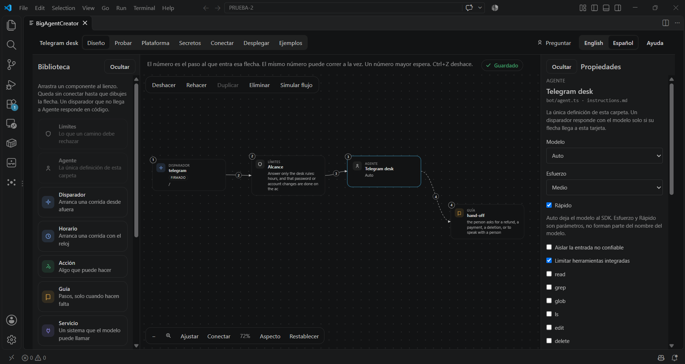
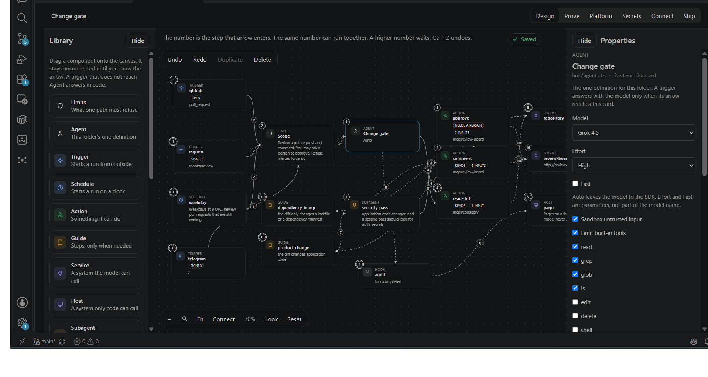
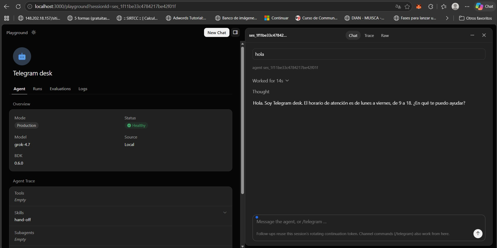
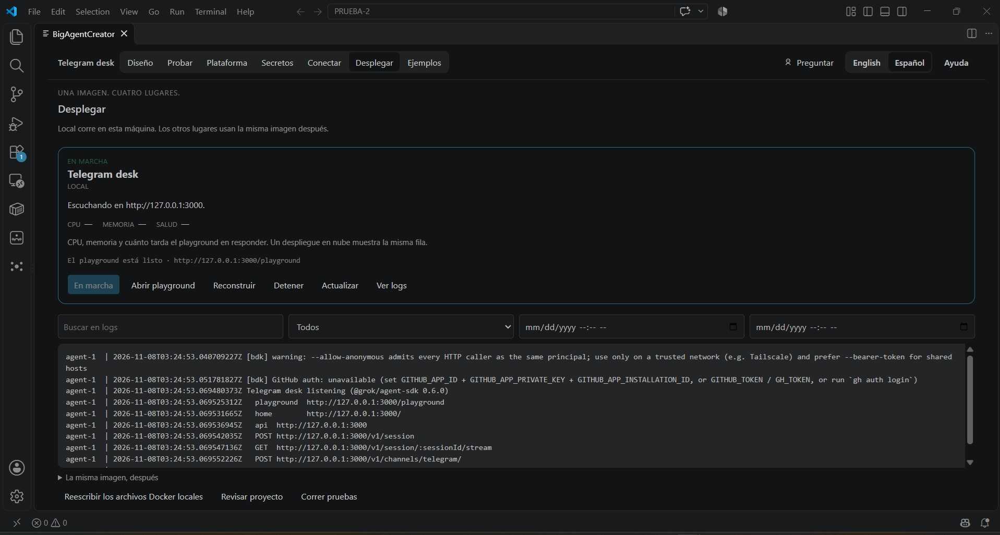

# BigAgentCreator



Design an AI agent as a workflow on a canvas, save it as a folder, and run that folder in Docker on your machine.

You stay in VS Code or Cursor. The drawing is not a picture of the agent. Each save writes the Agent SDK files. A trigger, a tool, a guide, and a Telegram chat are files you can open. Secret values stay in `.env`. The image never contains one.

| A larger flow | Playground | Telegram |
| --- | --- | --- |
|  |  |  |

## What you can build

- A **Telegram bot** that answers from rules you wrote, refuses what you marked as out of bounds, and replies in the same chat.
- **Several ways in.** Telegram, a webhook, a schedule. Each arrow is a path. Two triggers can reach the agent. One can skip it.
- A **path with no model.** If a trigger never reaches the Agent card, that path answers in code. A message can come in, a function can multiply it by two, and nothing calls an LLM.
- **One agent definition per folder.** The Agent card is `bot/agent.ts` and `instructions.md`: name, model, and instructions. Remove it when the flow does not need it. Add a subagent when the main agent should delegate.
- **Tools and guides.** An action is something the run can do. A guide loads only when it is needed. A service is a system the model may call. A host is a system only your code calls.
- **A local run you can try.** Ship builds the image and starts it. The playground is [http://127.0.0.1:3000/playground](http://127.0.0.1:3000/playground). Rebuild applies the current `.env` without copying secret values into the image.

## How a flow behaves

Dropping a card does not connect it. You draw the arrow. The number on a card is the step that arrow enters. The same number can run together. A higher number waits.

The model is the Cursor API (`CURSOR_API_KEY`). This Docker image cannot run the SDK sandbox, so the generator leaves that switch off.

## This release, 0.2.1

| | |
| --- | --- |
| Design | Canvas, Agent, limits, triggers, actions, guides, services, hosts, subagents, hooks. |
| Prove | Fixed cases you can add and open as TypeScript. |
| Secrets | Names in the project. Values in `.env`. Logs hide them. |
| Connect | Open a Cloudflare tunnel and register the Telegram webhook. The bot token is not shown. |
| Ship | Start, stop, rebuild, logs, and the playground link. |

Kubernetes, AWS, GCP, and Azure are the same image later: each cloud only starts it and injects the same secret names. 0.2.1 does not deploy there yet. The next step after that is a versioned image: build once, keep the digest, deploy that digest instead of an unnamed rebuild. The line is `ROADMAP.md` in the repository root. There is no second model runner.

## Start

1. Install the extension and open a folder. Use **Examples** and load **Telegram desk**, or open `examples/telegram-desk` yourself. The first load keeps your current files in `.keep/original`. **Restore my folder** puts them back.
2. Open **BigAgentCreator** on the activity bar.
3. Initialize the workspace if the folder has no agent files yet. Agent and Limits appear. Either can be removed.
4. In **Secrets**, set `CURSOR_API_KEY`. For Telegram also set `TELEGRAM_BOT_TOKEN` (the BotFather value, with the colon) and `TELEGRAM_WEBHOOK_SECRET` (letters, numbers, `_`, and `-` only).
5. **Ship → Start.** When the status says the playground is ready, open it and ask something the instructions allow.
6. For the real Telegram chat, point an HTTPS tunnel at port 3000 and use **Connect → Register webhook**. Then message the bot. Leave the tunnel open while you test.

## Develop this extension

From `apps/extension`:

```bash
npm install
npm test
npm run compile
npx @vscode/vsce@2.32.0 package --allow-missing-repository --skip-license
```

The Marketplace icon is `media/icon.png`. The activity bar uses `media/icon.svg`.
