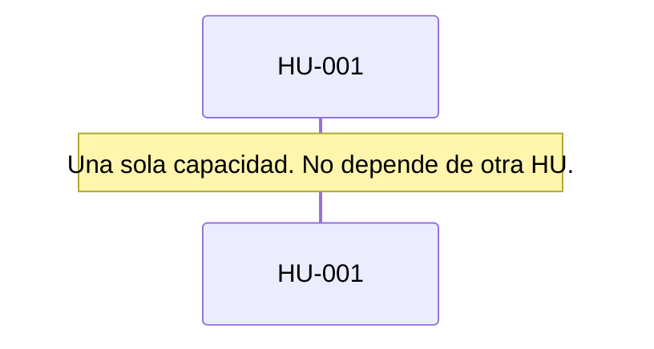

# Runbook 001 — WhatsApp

## Objetivo

Dejar WhatsApp tan guiado como Telegram y decirle al chat cómo traducir un pedido a tarjetas.

## HUs (fuente del qué)

- [HU-001](../../05-backlog/01-canales/E-001-llegar/F-001-whatsapp/HU-001-whatsapp.md)

## Negocio (secuencia)

## Pasos

| # | Tipo | Qué | Insumos | Status | % |
| --- | --- | --- | --- | --- | --- |
| 1 | analyze | Entender Telegram y la API de WhatsApp | HU-001 | `done` | 100 |
| 2 | compose | Spec 001 | HU-001 | `done` | 100 |
| 3 | implement | Canal, Conectar, pruebas, voz de la ayuda | spec 001 | `done` | 100 |

## Estado actual

- Paso corriente: 3 implement, probado por la IA
- Siguiente: los canales sin tarjeta de alta (Slack, GitHub, GitLab, Bitbucket)
- Bloqueos: ninguno. `closed` cuando la persona lo use en Meta.
