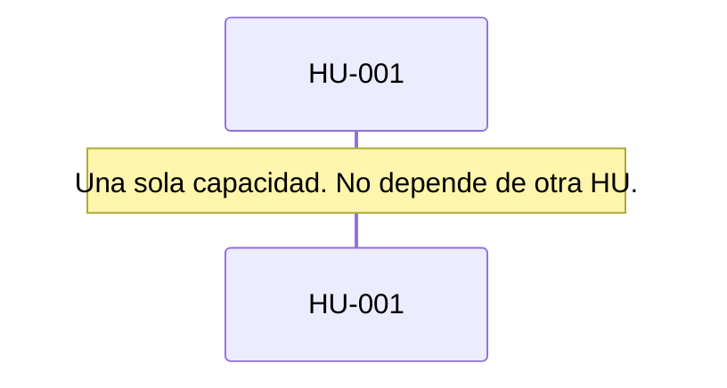

# Runbook 002 — Estado del agente local

## Objetivo

Que Ship diga si el agente local arrancó o falló, muestre su nombre y deje leer el log sin perder los controles.

## HUs (fuente del qué)

- [HU-001](../../05-backlog/02-despliegue/E-001-panel/F-001-local/HU-001-estado.md)

## Negocio (secuencia)

## Pasos

| # | Tipo | Qué | Insumos | Status | % |
| --- | --- | --- | --- | --- | --- |
| 1 | analyze | El estado no cambiaba tras Iniciar | HU-001 | `done` | 100 |
| 2 | compose | Spec 002 | HU-001 | `done` | 100 |
| 3 | implement | Barra, métricas, log y pruebas | spec 002 | `done` | 100 |

## Estado actual

- Paso corriente: 3 implement, probado por la IA
- Siguiente: la persona pulsa Iniciar y ve En marcha o Falló
- Bloqueos: ninguno. `closed` cuando la persona lo use.

## Mesa

| Rol | Dejó |
| --- | --- |
| implement | `composeIsRunning`, `failed`, nombre, CPU, memoria, latencia del playground, log con filtro. `npm test`. |
