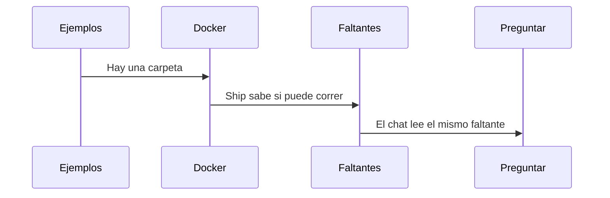

# Runbook 003 — Empezar y saber qué falta

## Objetivo

Que una carpeta vacía pueda nacer de un ejemplo, que Ship diga si falta Docker, y que el lienzo nombre lo que falta antes de abrir un chat.

## HUs (fuente del qué)

1. [Ejemplos](../../05-backlog/03-usar/E-001-empezar/F-001-ejemplos/HU-001-ejemplos.md)
2. [Docker](../../05-backlog/03-usar/E-001-empezar/F-002-docker/HU-001-docker.md)
3. [Faltantes](../../05-backlog/03-usar/E-001-empezar/F-003-faltantes/HU-001-faltantes.md)
4. [Preguntar](../../05-backlog/03-usar/E-001-empezar/F-004-preguntar/HU-001-preguntar.md)

Siguiente, fuera de este implement: [Escribir](../../05-backlog/03-usar/E-001-empezar/F-005-escribir/HU-001-escribir.md).

## Negocio (secuencia)

## Pasos

| # | Tipo | Qué | Insumos | Status | % |
| --- | --- | --- | --- | --- | --- |
| 1 | analyze | Orden: ejemplo, Docker, faltante, chat, y después escribir | las cinco HUs | `done` | 100 |
| 2 | compose | Spec 003 | las cuatro primeras | `done` | 100 |
| 3 | implement | Pantalla, estados y pruebas | spec 003 | `done` | 100 |

## Estado actual

- Paso corriente: 3 implement, probado por la IA
- Siguiente: la persona lo usa, y después F-005
- Bloqueos: ninguno. `closed` cuando la persona lo use.

## Mesa

| Rol | Dejó |
| --- | --- |
| implement | `data-init-example`, `dockerProblem`, `cardNeeds`, `flowReport`, `lmGate`. Cada ejemplo, sin `.env`, solo debe secretos (Change gate también el repositorio). El chat no escribe. |
